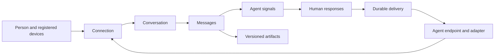

# Somae communication contract

Draft 0.1 · October 11, 2026

Somae gives a person one address and one interface for communicating with agents. This contract defines how messages, conversations, signals, responses, connections, and artifacts preserve that relationship across local coding agents, hosted coding agents, custom turn based agents, and custom durable agents.

The agent owns execution, its workspace, and its work state. Somae owns authorized communication, durable delivery, the human-facing presentation, and the record of what the person submitted. Receiving a response does not establish that an agent ran, finished, or successfully performed an action.

This is a proposed domain contract for review before implementation. The entity rules apply across transports. Exact provider adapters, endpoint names, authentication flows, and storage infrastructure are implementation choices.

An executable reference subset now lives in [`packages/domain`](../../packages/domain/README.md). Its [ontology](../../packages/domain/ontology.json) maps stable business-rule IDs to guards and behavioral tests. The reference runtime is independent of the browser prototype and uses an in-memory serialized command boundary. It does not implement production authentication, durable transactions, provider adapters, replay retention, or all future artifact/custom-UI behavior. Read its supported/deferred list before treating a documented rule as enforced in an application.

## 1. The model



A conversation is a continuing relationship around a subject. A message is an immutable communication in its timeline. A signal is an agent's mutable presentation of something the person should see or respond to. A response is the person's immutable submission to a particular signal revision. A connection authorizes the relationship. An artifact is a versioned piece of content attached to it.

The inbox is a view over these records, not an additional entity. Reading, snoozing, archiving, and muting are person-owned view state. They do not answer a request, revoke a connection, stop an agent, or change the agent-owned state of a signal.

### Identity and endpoints

- A person has a stable `person_id` and a changeable public handle. A handle locates a person; it is not a credential or permission to publish.
- An `agent_id` identifies the agent. An `endpoint_id` identifies the concrete integration that can receive communication: for example, a particular local installation, a hosted service, or a custom harness.
- The endpoint declares its hosting location, execution model, and capabilities. Declaring a capability does not grant it; the connection's permissions must also allow it.
- A local endpoint is bound to a registered machine identity. The server derives the origin device from authenticated client identity, not a caller-supplied device string.
- Names and logos are presentation. Routing and authorization use stable IDs.
- A conversation is bound to one connection and one endpoint. Agent-private routing references identify the provider thread, session, checkpoint, or actor. Somae treats those references as opaque and does not expose resumable credentials to clients.

The four fixtures are combinations of independent properties:

| Fixture | Hosting | Execution | Delivery destination |
| --- | --- | --- | --- |
| Local coding agent | Local, machine bound | Interactive session or resumable turn | Local adapter bound to the correct session |
| Hosted coding agent | Hosted | Provider-managed session or turn | Provider adapter with supported control APIs |
| Custom turn based agent | Hosted | Invocation that can end and resume later | Durable integration inbox plus harness dispatcher |
| Custom durable agent | Hosted | Persistent actor or durable event handler | Durable integration inbox plus actor/event router |

Durability is not a prerequisite for the shared contract. Every integration needs durable receipt and deduplication somewhere; a turn based harness can implement that without keeping an LLM process alive.

## 2. Connection

A connection binds one person to an agent endpoint and defines the authority for communication in both directions.

Required fields: `id`, `person_id`, `agent_id`, `endpoint_id`, `state`, `permissions`, `capabilities`, `created_at`, and `revision`. Include a machine binding for local endpoints and a reference to the registered delivery configuration. Delivery credentials and agent-private routing data are never embedded in client-visible content.

Connection states are `pending`, `active`, `paused`, and `revoked`. Only the person or an explicitly authorized administrator can approve, pause, resume, or revoke the relationship. An agent can disconnect its own endpoint. Ordinary messages and signals require an active connection; a pending connection cannot publish a signal that authorizes itself.

Capabilities describe support; permissions describe consent. The first contract needs to distinguish:

| Capability | Meaning |
| --- | --- |
| `messages.start` | Accept a person-initiated conversation/input |
| `messages.continue` | Accept a person-initiated follow-up in an existing conversation |
| `messages.publish` | Publish an agent message without creating a surfaced signal |
| `signals.publish` | Send an agent-authored signal |
| `signals.update` | Replace the presentation or request of an active signal |
| `signals.withdraw` | Withdraw an active signal |
| `responses.receive` | Receive a submission to a signal's declared interaction |
| `responses.remote_continuation` | Resume an already bound local session from a response submitted on another device |
| `artifacts.publish` | Attach files or structured artifacts |
| `artifacts.receive` | Accept the person's attachments, within advertised media-type and size limits |
| `artifacts.custom_ui` | Offer a custom presentation under Somae's host interaction contract |
| `context.receive` | Receive the context snapshots explicitly shared by the person |

Capabilities must be precise enough for the UI to explain an unavailable action. A notification-only connector advertises fewer capabilities; it is not presented as a fully interactive integration. A deterministic approval adapter and an adapter capable of free-text continuation are distinct supports, recorded in the declared interaction types.

**Pause:** reject new content publications and new user submissions; suspend delivery that has not reached its destination. Preserve accepted records and their delivery state. Authenticated withdrawal of an existing signal and receipts for already dispatched input remain permitted, so a pause does not preserve an obsolete request or erase a real delivery outcome. Resume only still-valid deliveries after the person resumes the connection.

**Revoke:** invalidate the grant, stop undelivered communication, and withdraw active signals with reason `connection_revoked`. Preserve the person's history. Already delivered input cannot be recalled by revoking a connection.

Receipts for previously dispatched deliveries use delivery-bound authorization. They can finish that record after pause or revocation without restoring any authority to send new content. Revocation is not a transport mechanism for cancelling effects already underway.

A handle-based connection proposal and a click-to-authorize flow produce the same final grant. Invitations are separate from ordinary inbox content; unsolicited handle lookup does not grant access to the person's profile, inbox, or context. Credential rotation preserves connection identity; a grant change increments its revision.

## 3. Conversation

A conversation is an append-only timeline with a stable destination. It survives individual agent turns and individual signals.

Required fields: `id`, `person_id`, `connection_id`, `endpoint_id`, `created_at`, `title`, and `sequence`. Optional fields include a subject/project label and agent-private continuity references. The title is descriptive metadata, never a routing key.

Either side may originate a conversation when the active connection allows it. A durable agent can initiate a relevant conversation without a preceding human message. The originating command atomically creates the conversation and its first message or signal.

Version 0.1 has one person and one agent endpoint per conversation. Multiple agents can appear in the person's unified inbox through separate conversations. Moving a conversation to another endpoint, sharing it with another agent, or adding participants requires a future explicit handoff contract and renewed context consent.

Archiving changes the person's view. It does not close an agent session. Agents may continue a conversation when its connection and routing references remain valid. A missing or expired provider session produces a meaningful delivery rejection; the adapter must not silently substitute a different session or workspace.

## 4. Message

A message is immutable authored communication. Both people and agents can author messages. Messages provide the timeline; signals add attention and interaction semantics to agent messages.

Required fields: `id`, `conversation_id`, `author`, `created_at`, `sequence`, `content`, and `artifact_refs`. Optional fields: `in_reply_to_message_id`, `origin`, `context_snapshot_refs`, and an opaque adapter correlation reference.

`content` is an ordered list of typed blocks. The initial vocabulary is text/Markdown, image references, file references, structured data, and artifact references. Every rich message provides a readable text fallback. A display update is a new message or artifact revision, not an edit that changes previously submitted evidence.

A person can submit a message to start a conversation or continue an existing one when the endpoint and connection permit the operation. An agent can publish a result, explanation, or notice without asking for a decision. Receiving an agent message does not implicitly create a pending approval.

Human drafts stay client-owned until submitted. On submission, Somae durably stores the message and its delivery record. The client may show "Saved in Somae" or "Queued" while delivery is pending. A provider-specific result arrives as a later agent message, optionally surfaced by a signal. Sending a message never increases the count of requests awaiting the person.

### Initiation and local continuation

For hosted endpoints, authorized starts and follow-ups are permitted from supported authenticated devices. Transient endpoint downtime can queue an input if the endpoint supports durable delivery; a disconnected integration or unsupported capability rejects it. Availability and permission are separate facts.

For local endpoints, person-initiated starts and unsolicited follow-up messages require Somae on the same registered machine and an available local adapter. No queue or mobile client silently turns another machine's local endpoint into a hosted endpoint.

A local endpoint may separately offer an explicit continuation interaction on a signal. With the `responses.remote_continuation` grant, a phone can submit a response to that existing signal, bound to its existing session/workspace. This can start another turn in that session. It cannot select a new local session, machine, or workspace. Arbitrary `message.submit` from another device remains disallowed, even when it supplies an existing conversation ID.

Natural-language follow-ups can request more work. Somae enforces the authorized destination and session boundary; it does not pretend that it can classify every free-text reply as "new work" versus "continuation." If that distinction must be narrower, the agent offers structured choices rather than a free-text continuation.

## 5. Signal

A signal is an agent-authored surface attached to a message in a conversation. It may present an answer, an artifact, a notice, a question, or an approval request. All signals have an attention lifecycle; only those with a required interaction count as waiting for the person.

Required fields: `id`, `conversation_id`, `connection_id`, `message_id`, `revision`, `kind`, `state`, `created_at`, `updated_at`, `interaction`, and `presentation`. Optional fields: `expires_at`, `in_reply_to_message_id`, `supersedes_signal_id`, and a bounded opaque `continuation_ref` known only to the adapter/harness.

Kinds initially are `result`, `notice`, `question`, and `approval`. A result can offer an optional "reply to continue" interaction. A question or approval requires an interaction. Kind is descriptive; authorization depends on the actual interaction and the connection's grant.

Signal states:

| State | Meaning |
| --- | --- |
| `active` | Visible and eligible for its declared interactions |
| `answered` | Somae durably accepted a terminal response from the person |
| `withdrawn` | The agent or a connection policy withdrew the active signal |
| `expired` | Its decision window ended before Somae accepted a terminal response |

Only `active` signals can be updated, withdrawn, or answered. A server-serialized transition wins once. Terminal signals stay terminal. A new request after an answer uses a new signal ID, with `supersedes_signal_id` when useful. An informational signal can remain active after it is read; reading is user state, not an answer.

Updating a signal increments its revision and points to a new immutable message/presentation. Previous revisions remain inspectable. Changes to content, terms, options, form schema, artifact versions, or deadline all invalidate the old revision for a new response. Clients retain an unsent draft as a draft but require review of the current revision; they do not auto-submit it against changed terms.

Withdrawal removes the signal from the actionable surface and explains why. It does not delete timeline history. If an answer won the race first, withdrawal returns `signal_already_answered`; the harness can reject an input it can no longer apply, explain the change, and publish a replacement signal. It cannot silently erase the person's answer.

### Interaction

`interaction` is null or describes a stable interaction ID, a mode (`required` or `optional`), response type, validation schema, allowed actions, and human-readable consequences. Initial response types are text, single choice, multiple choice, form, and explicit approval. Stable option/action IDs are distinct from labels.

A signal has at most one terminal response in version 0.1. Choices/forms are submitted together. An agent needing multiple rounds publishes the next signal in the same conversation. An optional continuation consumes the result's interaction and leads to the next agent turn; it does not count as blocking beforehand.

Acknowledging or answering a request in the provider's original interface can also resolve it. The adapter withdraws a still-active Somae signal with reason `resolved_elsewhere`. If a Somae response was already accepted but the provider accepted a competing answer first, the adapter reports that Somae input as rejected. Somae cannot make an atomic transaction with another application's UI; the destination's authoritative pending-request state decides which input it can apply.

Approval terms include the concrete operation and relevant scope, cost, target, or artifact version. A client-visible summary and the server-side interaction refer to the same pinned terms. Changing terms requires a new signal revision or replacement signal. A generic "yes" cannot authorize a different operation.

### Presentation

`presentation` selects a native view, structured interaction, rich artifact, or custom UI. Text and native response controls provide a fallback on clients that do not support the richer view.

Custom UI can collect or preview values and request submission through a narrow host API. Somae performs authorization, validation, revision checking, and explicit user submission. Embedded content receives no connection credentials, cannot forge sender identity or permission chrome, cannot read arbitrary context, and cannot create an approval merely by loading. A builder can control the content experience without controlling the trusted receipt and authorization boundary.

## 6. Response

A response is an immutable human submission to a signal's exact interaction revision. It also creates a human-authored message in the conversation timeline; `Response` and that message are two views of one submission, linked by `message_id`.

Required fields: `id`, `signal_id`, `signal_revision`, `interaction_id`, `conversation_id`, `message_id`, `person_id`, `origin_device_id`, `submitted_at`, `value`, `artifact_refs`, and `delivery_id`.

The server atomically validates the grant, device/session policy, active signal, expiry, interaction schema, pinned artifact terms, and expected revision; then stores the response and its timeline message, transitions the signal to `answered`, and records an outbound event. A response cannot appear accepted in one store while absent from the delivery queue.

`response.submit` can include optional typed `content` and explicitly pinned `artifact_refs` alongside its structured value. The timeline message starts with the canonical answer, followed by this feedback, and has one outbox delivery. Extra content uses the same readable-message and artifact guards; it cannot substitute another answer, change the request terms, or bypass revision checks. A malformed comment block or attachment rejects the entire submission.

A successful submit means **Somae accepted the response**. Delivery and application receipts separately describe what happened next. The first valid terminal submission wins across devices. An identical idempotent retry returns that same response; a competing second submission receives `signal_already_answered` and the canonical state.

Responses do not claim to cancel or reverse an agent action. After submission, a correction is a follow-up message, replacement request, or explicit cancellation operation supported by the receiving agent. The prototype's Undo is not a universal protocol guarantee.

Expiry is checked at submission and before delivery of a time-bound continuation. A response accepted before expiry can still have an expired delivery if the destination remained offline past its validity window. The signal stays `answered`; the receipt clearly says the response could not be delivered in time. The harness also revalidates real-world conditions before applying an input.

## 7. Artifact

An artifact is a versioned content object associated with an authorized conversation: image, document, code/diff, structured data, or a custom application presentation.

Required fields: `id`, `revision`, `conversation_id`, `publisher`, `media_type`, `presentation_type`, `created_at`, `content_ref`, and a content digest. Include size and a readable description/fallback. External content references require an explicit origin and access policy; fetch/display of content does not grant an agent new authority.

Artifact revisions are immutable. Messages and interactions pin `{artifact_id, revision}` rather than "latest." An agent can publish a new revision, then update an active signal to show it. An approval never changes its referenced artifact behind the person's back.

The person's attachment can be stored privately before sending. Delivering it to an agent requires explicit inclusion on that message or response and the endpoint's supported receive capability. Declared file types and size limits determine the attachment controls; an unsupported attachment is not silently discarded.

Access is scoped to the person and explicitly authorized conversation participants. Publishing an artifact to one conversation does not expose it to the person's other agents. Custom applications declare the host interaction version and supported capabilities; unsupported clients show the fallback and any supported native controls.

Artifact storage retention and personal deletion are separate from withdrawal. A withdrawn request may retain its referenced artifact in the person's history. The final retention/deletion policy must be explicit before launch.

## 8. Context

Context travels as a versioned snapshot chosen by the person, with a declared audience and purpose. A public handle and an active connection do not expose the person's entire context.

A message references the exact context snapshots shared with it. The adapter cannot silently fetch a newer or broader profile. A conversation can carry selected context forward within the same authorized scope; adding more context or another agent requires consent. Source updates do not rewrite what an earlier message disclosed.

Version 0.1 supports explicit inclusion on a message. A future ongoing context grant can declare a narrow scope and access rules. Revocation prevents future authorized reads and deliveries; it does not claim to erase copies already delivered to an agent.

## 9. Commands and events

Commands express intent; events record accepted changes. Domain names below define semantics rather than a final HTTP route layout.

| Command | Caller | Result |
| --- | --- | --- |
| `connection.propose`, `connection.approve` | Agent proposes; person approves | Establish the scoped relationship |
| `connection.pause`, `connection.resume`, `connection.revoke` | Person | Change communication authority |
| `message.submit` | Person | Append an authorized start/follow-up and queue delivery |
| `message.publish` | Agent | Append an agent message without requiring a decision |
| `signal.publish` | Agent | Append a message and create its surfaced signal atomically; this capability includes that message publication |
| `signal.update` | Owning agent | Publish the next presentation revision of an active signal |
| `signal.withdraw` | Owning agent or policy | Withdraw an active signal with a reason |
| `response.submit` | Person | Atomically accept one response and queue it |
| `artifact.publish` | Authorized publisher | Publish an immutable artifact revision |
| `delivery.ack` | Destination adapter | Durably accept delivery responsibility |
| `input.accept`, `input.reject` | Destination adapter/harness | Report whether the exact input can be applied |

Commands carry an idempotency key scoped to the authenticated actor and operation. Reusing a key with the same payload returns the original result when the caller is still authorized to retrieve it; reusing it for different content rejects it. Revision-changing commands also carry `expected_revision`. Idempotency never bypasses current authorization or reapplies an operation under a different grant.

Events include `connection.changed`, `message.created`, `signal.created`, `signal.updated`, `signal.answered`, `signal.withdrawn`, `signal.expired`, `response.submitted`, `artifact.published`, `delivery.received`, `delivery.failed`, `delivery.expired`, `input.accepted`, and `input.rejected`.

Each event has an immutable event ID, protocol version, type, authenticated source, timestamp, audience, conversation/entity IDs, entity revision, conversation sequence where relevant, and causation/correlation references. Resource IDs and event IDs are distinct. Server timestamps and sequence determine authority; client clocks do not.

The event is a notification of canonical state, not a competing state store. Clients can resync from records and a replay cursor after being offline. Agent deliveries use a recipient-specific cursor or queue; they never receive the whole person's event stream.

### Delivery guarantees

- Somae acknowledges a command only after durable storage and a durable delivery/outbox record when required.
- Delivery is at least once. Retries reuse the same delivery/event ID; duplicates must not produce duplicate human records or repeated agent effects.
- The destination deduplicates before resuming or applying input. It acknowledges only after durable acceptance of delivery responsibility. A webhook returning success before recording the input is not compliant.
- Where a provider exposes no idempotent input or recoverable acceptance receipt, a crash after forwarding creates an ambiguous outcome. The adapter records `input_outcome_unknown` and stops automatic reinjection until it can reconcile or obtain explicit recovery. It must not guess that another natural-language turn or approval is safe to submit twice.
- Webhooks, authenticated outbound streams/polling, and a future queue transport can carry the same event contract. Local adapters establish an outbound connection; Somae does not expose a local machine's inbound port as the public agent interface.
- Each conversation supplies ordering metadata. An event arriving late or twice does not roll a newer resource revision backward. Consumers detect gaps, replay, or fetch canonical state.
- Replay retention, retry intervals, and idempotency retention are published server policy. Clients receiving an out-of-retention cursor obtain a snapshot and a fresh cursor rather than silently skipping changes.
- Offline is different from revoked, paused, or incapable. Pending delivery has visible status and an expiry policy. Invalid/expired routing references reject instead of delivering to an arbitrary replacement session.
- Somae does not promise exactly-once external execution. The harness must deduplicate its own side effects and preserve its own execution/checkpoint semantics.

### Receipts

There are three distinct facts:

1. **Stored:** Somae durably accepted the message or response.
2. **Received by integration:** the destination adapter durably accepted responsibility; delivery can stop retrying.
3. **Input accepted or rejected:** the integration confirmed that the intended session/harness can apply this input, or gave a reason it cannot.

An adapter's receipt identifies the hop it represents. A local bridge buffering a reply does not claim that the coding agent read it. If a provider does not expose application acceptance, show that fact as unknown; an adapter must not manufacture it. Further agent output is a new message/signal, not a work-completion receipt.

After an integration acknowledges receipt, it owns reliable completion of the handoff or an explicit rejection. It cannot silently lose the input between its inbox and its agent invocation.

A supporting delivery record includes its ID, input reference, recipient endpoint, connection, validity deadline, attempt metadata, receipt provenance, and state (`queued`, `paused`, `received`, `failed`, `expired`, or `revoked`). Optional application receipts distinguish accepted, rejected, and ambiguous outcomes. Device push notifications are best-effort wake-up hints; the canonical inbox and replay path carry the durable communication.

### Errors

Stable domain error codes initially include `connection_inactive`, `capability_unsupported`, `origin_device_disallowed`, `endpoint_unavailable`, `signal_stale`, `signal_already_answered`, `signal_withdrawn`, `signal_expired`, `interaction_invalid`, `artifact_revision_invalid`, `continuation_unavailable`, `input_outcome_unknown`, `idempotency_conflict`, and `cursor_expired`.

Errors include a safe explanation and canonical state/revision when authorized. They do not expose provider credentials, another person's records, or agent-private execution secrets. Clients recover from a stale signal by fetching the current revision and asking the person to review it.

## 10. Examples

A hosted agent publishes a question. Presentation and execution routing are distinct:

```json
{
  "command": "signal.publish",
  "idempotency_key": "review-question-1",
  "conversation_id": "conversation_1",
  "in_reply_to_message_id": "message_1",
  "kind": "question",
  "content": [{ "type": "text", "text": "Which direction should I develop?" }],
  "artifact_refs": [{ "artifact_id": "artifact_1", "revision": 2 }],
  "interaction": {
    "id": "choose_direction",
    "mode": "required",
    "response_type": "single_choice",
    "actions": [
      { "id": "volt", "label": "Develop Volt" },
      { "id": "type", "label": "Develop Type" }
    ],
    "consequences": "Starts another design pass. Does not publish."
  },
  "presentation": { "type": "native_choice", "artifact_id": "artifact_1", "artifact_revision": 2 },
  "continuation_ref": "opaque-harness-checkpoint-reference"
}
```

The authenticated connection supplies the publisher and recipient identity. The server returns the new signal/message IDs and revision 1. Human response submission is bound to that version:

```json
{
  "command": "response.submit",
  "idempotency_key": "device-submission-1",
  "signal_id": "signal_1",
  "expected_revision": 1,
  "interaction_id": "choose_direction",
  "value": { "option_id": "volt" }
}
```

The server derives the person and origin device, validates the allowed option, and atomically records the response. The delivery payload to the adapter includes the canonical response, pinned signal revision/terms, and authorized continuation reference. It does not require the person or embedded UI to supply private routing data.

In a separate unanswered branch, the agent updates a signal using its expected revision, publishing a new immutable message and incrementing the signal revision. Withdrawal uses a reason and expected revision:

```json
{
  "command": "signal.withdraw",
  "idempotency_key": "obsolete-question-1",
  "signal_id": "signal_1",
  "expected_revision": 2,
  "reason": "The review is no longer needed."
}
```

If the person already answered or the revision changed, that withdrawal loses the race and returns the appropriate canonical state.

## 11. Walking all four integrations

### Local coding agent

1. The person authorizes an installation bound to their computer. The adapter advertises only the actual operations it can reliably perform.
2. Somae on that machine submits a message. The adapter binds the conversation to the correct provider session and workspace, records receipt, and reports acceptance when known.
3. A deterministic completion hook may report an agent result. A supported permission/user-input integration may publish an interactive signal. Hooks that only notify do not imply an ability to deliver a response.
4. If the agent wants free-text continuation from other devices, it offers that interaction with an authorized continuation bound to its existing session. The person can respond on a phone; the bridge routes the same response back to that session.
5. If the computer is asleep, the response remains visibly queued only while its continuation is valid. It cannot create a new local session remotely. If the session disappeared or its lease expired, reject clearly and ask for a new local initiation.
6. Restart recovery uses the adapter's durable routing/deduplication state. If a provider exposes no safe session continuation, the connector remains notification-only for that case.

### Hosted coding agent

1. The person authorizes the provider account and a supported endpoint. Starts and follow-ups can originate on desktop or mobile.
2. The adapter creates or binds a provider thread using its actual control API. Acknowledging receipt of an input does not imply that provider work finished.
3. Provider events or deterministic polling publish results and interactive signals. Stable provider event IDs become adapter deduplication keys; display messages are not scraped into reliable approval controls without an authoritative mapping.
4. A response maps to the provider's exact pending request/turn/session. If the provider accepts only some interaction types, the signal advertises only those types.
5. A result is published with optional continuation when supported. The next human message/response continues the conversation; it does not create a Somae task record.
6. A withdrawn provider request becomes a withdrawn Somae signal. Provider session invalidation and authorization revocation produce explicit receipts and state changes.

### Custom turn based agent

1. The developer exposes a durable input inbox/dispatcher and uses the SDK in their harness. A human message starts an invocation with the conversation reference and the exact context snapshots shared.
2. Before asking a question, the harness persists its checkpoint/continuation and the signal publication intent. It publishes the signal with a stable idempotency key, records the returned IDs, and may end the invocation.
3. A webhook or poll receives the response. The integration persists and deduplicates it before acknowledging delivery, then schedules another invocation with the continuation reference and pinned response.
4. The invocation validates that its checkpoint and requested operation remain applicable. It reports input acceptance/rejection and publishes its next result or question in the same conversation.
5. If the harness crashes between publication and recording the returned signal ID, its idempotent retry recovers the same signal. If it crashes between receiving and resuming, its durable dispatcher retries the resume without duplicating side effects.
6. The SDK does not require the LLM to decide whether to notify, nor an open tool/HTTP call waiting for the person. A higher-level synchronous-looking SDK helper can be added only over these durable primitives.

### Custom durable agent

1. A connected actor/event handler receives a person message or an authorized external event. Its execution state remains in its own runtime.
2. It may originate a conversation and signal without a prior person message when the connection allows it, such as a relevant change or approval request.
3. It persists pending-request identity and publication intent, updates active signals as facts change, and withdraws them when the request disappears. Stable event/idempotency keys prevent duplicate signals after replay.
4. A person response is an event routed to the same actor. Deduplication, checkpoint handling, and applying the decision occur in the actor's own serialized or transactionally protected state.
5. Timers or external events may invalidate the request while delivery is in flight. The actor rejects a no-longer-applicable input, publishes an explanation/replacement when useful, and never treats delivery alone as permission to apply stale terms.
6. The person sees the same conversation, signal, and receipt model as the other integrations. Somae does not mirror the actor's internal event log or scheduling lifecycle into a task dashboard.

## 12. Integration layers

The SDK exposes these domain operations directly. MCP makes authorized Somae operations available as tools. Skills teach agent behavior and presentation conventions. Hooks and harness events provide deterministic publication when the runtime exposes a reliable event.

Guaranteed lifecycle publication belongs in the harness/adapter. The agent can author explanations, questions, options, and artifacts. An MCP tool or skill alone does not guarantee that an LLM will publish a completion, and a notification hook alone does not establish arbitrary bidirectional session control.

Provider-specific approvals, user-input requests, conversation IDs, and artifacts are normalized by adapters. Somae's signal format is a product contract; it is not a claim that existing providers natively implement it. Capability negotiation and adapter conformance prevent unsupported controls from appearing in the UI.

## 13. Conformance scenarios before implementation

The first implementation must demonstrate the following against each applicable fixture:

| Scenario | Required result |
| --- | --- |
| Publish the same signal twice after a timeout | One signal, one timeline creation, same IDs returned |
| Submit from desktop and phone at once | One terminal response; other device receives canonical answered state |
| Agent changes choices/artifact while a draft is open | Old revision rejected; draft retained for human review |
| Withdrawal races response | Exactly one authoritative terminal transition; loser receives canonical state |
| Adapter crashes after receiving input | Deduplicated recovery; a provider handoff with an ambiguous outcome stops automatic reinjection |
| Turn based harness exits after asking | Response resumes a later invocation from its own checkpoint |
| Local phone starts a new conversation | Rejected even when that computer is online |
| Local phone answers an authorized existing continuation | Bound response delivered or visibly queued; no new session/workspace |
| Endpoint is offline beyond continuation validity | Explicit expired delivery; no silent application later |
| Connection is paused/revoked during delivery | Undelivered communication suspended/terminated according to policy |
| Artifact publishes a newer revision | Existing approval remains pinned to its original revision |
| Custom UI/client does not support rich presentation | Readable fallback and supported native interactions remain available |
| Client reconnects after missed events | Replay or snapshot restores current state without resurrecting obsolete signals |
| Informational result arrives | Unread result is visible; it is not counted as a required response |
| Provider supports notifications but no continuation | Notification-only capability is clear; no fabricated reply action |
| Request is answered in the provider's original UI | Withdraw the active mirrored request or reject a competing queued Somae response |

## 14. Decisions to review

The domain contract can support all four fixtures with the decisions above. Before implementation, confirm these product policies:

1. **Local remote continuation:** allow a phone response to an explicitly offered interaction in an existing local session; keep fresh starts and unsolicited follow-ups local-only. A free-text response can start another turn in that session.
2. **Result presentation:** agent messages may surface as signals; optional continuation does not count as blocking. The inbox distinguishes unread results from required responses.
3. **Initial participants:** one person and one agent endpoint per conversation. Agent-to-agent transfer or group conversations come later through explicit consent.
4. **Rich UI:** native text/choice/form interactions first, with an extensible artifact/custom-UI contract and readable fallbacks. Custom UI never owns the authorization boundary.
5. **Operational policy:** choose replay/idempotency retention, delivery validity limits, invitation policy, artifact retention/deletion, and retry timing before launch. These are published policy, not implicit infinite guarantees.

The first integration spike should validate authoritative bidirectional control for the chosen local and hosted coding agents. The custom harness fixtures can implement the contract directly; provider support may constrain which capabilities their adapters can honestly expose.

## 15. Desktop review and library test version · October 18, 2026

The first product slice now uses Electrobun/Bun on desktop, Claude Code Channels for a two-way local chat bridge, and a private Cloudflare Worker with SQLite-backed per-person Durable Object storage and R2 originals. Mobile is deferred for this test. The [execution brief](test-version.md) records the full outcome and verification requirements. The reference kernel remains independent of these transports.

The library adds immutable, version-bound reviews, content-review requests and per-artifact decisions above the communication entities. These are enforced in `packages/library`, with host types, ordinary tests and linked ontology rules. A review can carry `approve` or `reject` with optional notes; both decisions notify the agent even when there are no notes. Text feedback pins a block, UTF-16 range and exact quote; image feedback pins normalized geometry in an exact version. A new artifact version rejects a stale unsubmitted review without discarding its draft. Suggested replacements are proposed changes, not edits already applied. An agent revision can explicitly reference the review that prompted it.

`agent.review`, exposed by the Claude channel as `request_review`, publishes a structured approval signal for an exact set of artifact versions. Its terms specify `operation: review_artifacts` and `scope: content_review_only`; the library retains the signal/revision and artifact association explicitly. The review canvas answers that request directly. `review.submit.source_request` pins the signal revision and interaction ID; structured review requests include the exact offered approval value. A structured review must include its complete artifact set and matching approve/reject action and terms digest. The review, decision history, approval pins, response, answered signal, draft removal and one human message/outbox commit together. A failure leaves the draft intact. An overlapping active structured request prevents an independent decision from silently leaving that request unanswered. If several requests overlap, the person answers one exact request; unrelated requests remain pending.

Agent questions retain their exact offered choices, or a free-text answer when no choices were offered. The artifact canvas sends `source_request.value` with no review decision or decision sequences: the canonical answer, optional pinned comments, answered signal and one human message/outbox commit atomically. Zero-comment answers are valid. A question answer never changes artifact approvals or decision history, even when an agent-authored choice happens to say “approve.” Fixed **Approve** / **Request changes** actions belong only to structured `agent.review` requests. Wording and shared artifacts never convert a question into an approval request; no choice is inferred, replaced or withdrawn. Content review cannot answer an execution approval. Without a source request, a review sends one standalone message and delivery. `version.approve` remains a compatibility alias that sends a one-artifact approval and compatible saved draft feedback; unfinished or incompatible drafts reject safely. Already cached historical approvals retain their original result without retroactive delivery.

A content-review decision does not grant permission to execute an agent tool or publish externally. Each reviewed artifact compares its exact current decision sequence and retains immutable approval/rejection history. Approval pins the reviewed version. Rejection removes an approval of that same version, while retaining an approved older copy. Newer drafts never move these pointers. An idempotent retry returns the original decision and delivery after rechecking authority. Reading, Done and set-aside still affect only the person's queue; Done cannot hide a required unanswered interaction.

The Worker persists communication snapshots and library state together in a SQLite transaction before acknowledging accepted operations. Only audience-scoped projections leave that host. Original bytes are checked against a SHA-256 digest and retained under immutable content keys. The local channel journals each handoff before forwarding. On restart, a forwarded but unaccepted input becomes visibly uncertain rather than being automatically reinjected. Terminal-originated work can open a session-bound conversation through guarded endpoint-authored message publication; it does not fabricate an inbound person message or delivery. Native and deployed behavior require separate live evidence in addition to implementation tests.

## References

These primary references establish external mechanisms. Somae's entity and lifecycle choices above are proposed product decisions.

- [Claude Code hooks](https://code.claude.com/docs/en/hooks) distinguish notifications from permission decisions and document deferred tool calls for headless callers. An interactive hook is not automatically a durable continuation facility.
- [Claude Agent SDK user input](https://code.claude.com/docs/en/agent-sdk/user-input) exposes approvals and questions through `canUseTool`, which pauses execution until a response. Adapting a live callback and persisting a custom turn based continuation are different integration paths.
- [Codex app-server](https://developers.openai.com/codex/app-server) exposes threads, turns, server-initiated approval/user-input requests, and request-resolution events. It provides a concrete interface for a client-owned integration; it does not by itself establish safe control over an arbitrary already-running CLI session.
- [MCP elicitation 2025-11-25](https://modelcontextprotocol.io/specification/2025-11-25/client/elicitation) defines client-mediated form and URL interactions. It does not replace Somae's durable records, audience rules, delivery receipts, or client experience.
- [CloudEvents 1.0.2](https://raw.githubusercontent.com/cloudevents/spec/v1.0.2/cloudevents/spec.md) defines stable event identity through source and ID, including duplicate identification. It is a candidate interoperable envelope for the domain events, not a promise of exactly-once execution.
- [Standard Webhooks](https://github.com/standard-webhooks/standard-webhooks/blob/main/spec/standard-webhooks.md) describes signing the exact payload together with the event ID and delivery-attempt timestamp; retried attempts preserve the event ID. It is a candidate HTTP delivery profile for the same domain contract.

Research working files: `/tmp/somae-contract-integration-references.json`, `/tmp/somae-contract-codex-reference.json`, `/tmp/somae-contract-delivery-references.json`, and `/tmp/somae-contract-event-reference.json`. They are not protocol dependencies or deployment artifacts.
